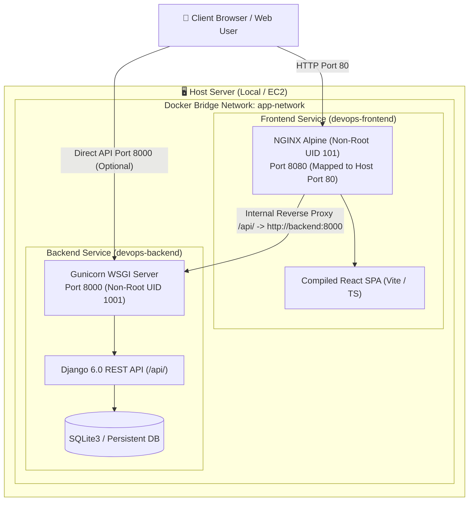

# 🚀 DevOps Assessment: Full-Stack Deployment & CI/CD Pipeline

A production-grade containerization, automation, and deployment implementation for a full-stack **Django REST API** and **React (Vite + TypeScript)** application using industry-standard DevOps practices.

---

## 📑 Table of Contents
1. [Architecture Overview](#-architecture-overview)
2. [Phase 1: Containerization & Security](#-phase-1-containerization--security)
   - [Multi-Stage Builds & Image Optimization](#multi-stage-builds--image-optimization)
   - [Security & Non-Root Execution](#security--non-root-execution)
   - [Docker Compose Orchestration](#docker-compose-orchestration)
3. [Phase 2: CI/CD Automation (GitHub Actions & Jenkins)](#-phase-2-cicd-automation-github-actions--jenkins)
   - [GitHub Actions Workflow](#github-actions-workflow)
   - [Jenkins Declarative Pipeline](#jenkins-declarative-pipeline)
   - [Automated Deployment Script](#automated-deployment-script)
4. [Phase 3: Infrastructure as Code (Terraform)](#-phase-3-infrastructure-as-code-terraform)
   - [AWS Infrastructure Architecture](#aws-infrastructure-architecture)
   - [Security Group Hardening](#security-group-hardening)
5. [Phase 4: Step-by-Step Setup Guide](#-phase-4-step-by-step-setup-guide)
   - [Quick Start (Local Deployment)](#quick-start-local-deployment)
   - [Environment Variables Configuration](#environment-variables-configuration)
   - [Manual / Development Setup](#manual--development-setup)
6. [Phase 5: Real-World Troubleshooting Log](#-phase-5-real-world-troubleshooting-log)
   - [Issue 1: npm Package Alias Version Incompatibility (`rolldown-vite`)](#issue-1-npm-package-alias-version-incompatibility-rolldown-vite)
   - [Issue 2: Alpine Linux IPv6 Health Check Resolution Mismatch](#issue-2-alpine-linux-ipv6-health-check-resolution-mismatch)
   - [Issue 3: Non-Root Permissions for Static Files & Database Migrations](#issue-3-non-root-permissions-for-static-files--database-migrations)
7. [Verification Evidence & Live Test Outputs](#-verification-evidence--live-test-outputs)

---

## 🏗 Architecture Overview



### Key Architectural Decisions
- **NGINX Reverse Proxy**: The frontend container serves the static React assets and reverse-proxies `/api/` calls to the backend service. This eliminates browser CORS complications and allows single-port entry.
- **Direct Port Mapping**: Port `8000` is also mapped directly to allow isolated API testing and headless service integrations.
- **Isolated Bridge Network**: Both containers communicate across an internal Docker network (`app-network`) without exposing internal container ports directly unless explicitly configured.

---

## 🐳 Phase 1: Containerization & Security

### Multi-Stage Builds & Image Optimization

Both services utilize **multi-stage Docker builds** to separate compile-time build dependencies (compilers, npm build chains, header files) from lightweight production runtime images.

#### 1. Backend (`backend/Dockerfile`):
- **Stage 1 (Builder)**: Base `python:3.12-slim`. Installs `gcc` and `libpq-dev`, compiles wheel dependencies, and installs them to `/root/.local`.
- **Stage 2 (Runner)**: Clean `python:3.12-slim`. Copies only the pre-compiled Python binaries from the builder stage, installs minimal shared runtime libraries (`libpq5`, `curl`), and strips all build tooling.
- **Image Size**: **179 MB** (compared to >1.2 GB for a standard Python build image).

#### 2. Frontend (`frontend/Dockerfile`):
- **Stage 1 (Builder)**: Base `node:20-alpine`. Installs npm packages cleanly via `npm ci` and compiles the React TypeScript application using Vite into `/app/dist`.
- **Stage 2 (Runner)**: Base `nginxinc/nginx-unprivileged:alpine`. Copies only static production HTML/JS/CSS assets into `/usr/share/nginx/html`.
- **Image Size**: **61.1 MB** (compared to >1.1 GB for a Node development image).

```bash
$ docker images | grep fullstackapplication
fullstackapplication-frontend   latest   b6e823c7f009   61.1MB
fullstackapplication-backend    latest   4cd8dd91fe57   179MB
```

### Security & Non-Root Execution

Running container workloads as `root` creates severe container escape vulnerabilities. Both containers strictly run under dedicated non-root users:

- **Backend**:
  - Creates dedicated system group `appgroup` (GID 1001) and user `appuser` (UID 1001).
  - Explicit file ownership `chown -R appuser:appgroup /app`.
  - Directives: `USER appuser`.
- **Frontend**:
  - Leverages the official rootless NGINX image (`nginxinc/nginx-unprivileged:alpine`).
  - Runs under user `nginx` (UID 101) with unprivileged port bindings (`8080`).
  - Directive: `USER 101`.

```bash
$ docker exec devops-backend whoami && docker exec devops-backend id -u
appuser
1001

$ docker exec devops-frontend whoami && docker exec devops-frontend id -u
nginx
101
```

### Docker Compose Orchestration

The `docker-compose.yml` orchestrates both services with:
- **Inter-service health checks**: Frontend waits for backend to transition to `healthy` state before starting (`condition: service_healthy`).
- **Dynamic environment variables**: Configured via `.env` with fallback defaults.
- **Automatic restart policies**: `restart: unless-stopped`.

---

## 🔄 Phase 2: CI/CD Automation (GitHub Actions & Jenkins)

### GitHub Actions Workflow (`.github/workflows/ci-cd.yml`)

The repository includes a modern GitHub Actions workflow triggered on every `push` and `pull_request` to `main`:

```
┌─────────────────────────┐
│   Lint & Automated      │  • Validates Django configurations (python manage.py check)
│        Tests            │  • Executes unit tests (python manage.py test)
└────────────┬────────────┘  • Verifies React TypeScript builds (npm run build)
             │
             ▼
┌─────────────────────────┐
│   Build & Push Docker   │  • Multi-stage Docker build with Docker Buildx
│     to Registry         │  • Pushes to GitHub Container Registry (ghcr.io)
└────────────┬────────────┘  • Uses GitHub Actions cache (type=gha) for instant builds
             │
             ▼
┌─────────────────────────┐
│  Automated Deployment   │  • Validates Compose configurations
│     & Verification      │  • Triggers scripts/deploy.sh for local/self-hosted deployment
└─────────────────────────┘  • Validates live health endpoints via curl
```

### Jenkins Declarative Pipeline (`Jenkinsfile`)

To support enterprise Jenkins setups, a Declarative Jenkinsfile is included with stages:
1. `Checkout`: Fetches branch code from SCM.
2. `Backend Quality Checks`: Creates isolated Python virtual environment, installs dependencies, runs Django checks and tests.
3. `Frontend Build Check`: Runs npm install and executes production compilation.
4. `Docker Build & Push`: Builds multi-stage Docker images and pushes to Docker Registry.
5. `Deploy to Local / Host`: Invokes `./scripts/deploy.sh` and verifies container health.

### Automated Deployment Script (`scripts/deploy.sh`)

A standalone bash deployment script handles one-click deployment for local machines, self-hosted runners, or staging environments:
- Detects `docker compose` (v2 plugin) or `docker-compose` (standalone).
- Verifies and copies `.env.example` if `.env` does not exist.
- Rebuilds images with `--pull` and recreates containers with `--remove-orphans`.
- Polling health check loop (up to 15 retries) ensuring services report `healthy` before exiting.

---

## ☁️ Phase 3: Infrastructure as Code (Terraform)

Located in `terraform/`, the Terraform configuration provisions cloud infrastructure on AWS for running the containerized workload.

### AWS Infrastructure Architecture
- **VPC & Subnet**: Dedicated VPC (`10.0.0.0/16`) with an internet-facing public subnet (`10.0.1.0/24`).
- **Internet Gateway & Route Table**: Configures standard routing for public web traffic.
- **Virtual Machine**: AWS EC2 instance (`t3.micro` or `t2.micro`, Free Tier eligible) running Ubuntu 24.04 LTS.
- **Automated Cloud Bootstrapping**: `user_data` script automatically installs Docker Engine, Docker Buildx, and Docker Compose plugin on instance launch.

### Security Group Hardening
Per the assessment requirements, the security group (`aws_security_group.app_sg`) allows **strictly only ports 80, 443, and 22**:
- **Port 80 (HTTP)**: Ingress from `0.0.0.0/0` (Web traffic).
- **Port 443 (HTTPS)**: Ingress from `0.0.0.0/0` (SSL/TLS secure traffic).
- **Port 22 (SSH)**: Ingress restricted to admin CIDR (`var.allowed_ssh_cidr`).
- **All other ports**: Blocked by default.

---

## 📖 Phase 4: Step-by-Step Setup Guide

### Quick Start (Local Deployment)

#### 1. Clone the Repository
```bash
git clone <YOUR_PUBLIC_GITHUB_REPO_URL>
cd "Full Stack Application"
```

#### 2. Configure Environment Variables
```bash
cp .env.example .env
```
*(Optionally modify `.env` to adjust ports or set custom secret keys).*

#### 3. Run the Automated Deployment Script
```bash
chmod +x scripts/deploy.sh
./scripts/deploy.sh
```

Alternatively, use standard Docker Compose:
```bash
docker compose up -d --build
```

#### 4. Access the Application
- **Frontend Application**: [http://localhost](http://localhost) (or port `80`)
- **Backend API**: [http://localhost:8000/api/hello/](http://localhost:8000/api/hello/)
- **Health Check Endpoint**: [http://localhost:8000/api/health/](http://localhost:8000/api/health/)

---

### Environment Variables Configuration

| Variable | Default Value | Description |
| :--- | :--- | :--- |
| `SECRET_KEY` | *(Generated random key)* | Django cryptographic signing secret key |
| `DEBUG` | `False` | Django debug mode flag (`True` / `False`) |
| `ALLOWED_HOSTS` | `localhost,127.0.0.1,backend,frontend` | Permitted hostnames for Django requests |
| `CORS_ALLOW_ALL_ORIGINS` | `True` | Allows cross-origin requests |
| `BACKEND_PORT` | `8000` | Host port mapped to Django Gunicorn |
| `VITE_API_URL` | `http://localhost:8000` | Base URL used by React frontend to call the API |
| `FRONTEND_PORT` | `80` | Host port mapped to NGINX frontend |

---

### Manual / Development Setup (Without Docker)

#### Backend Setup
```bash
cd backend
python3 -m venv venv
source venv/bin/activate
pip install -r requirements.txt
python manage.py migrate
python manage.py runserver 0.0.0.0:8000
```

#### Frontend Setup
```bash
cd frontend
npm install
npm run dev
```

---

## 🛠 Phase 5: Real-World Troubleshooting Log

### Issue 1: npm Package Alias Version Incompatibility (`rolldown-vite`)

- **Symptom**: During initial dependency installation, running `npm install` on the local host failed with:
  ```text
  npm ERR! Invalid comparator: npm:rolldown-vite@7.2.5
  npm ERR! A complete log of this run can be found in: /home/.../.npm/_logs/...
  ```
- **Root Cause**: The repository's `package.json` specified `"vite": "npm:rolldown-vite@7.2.5"` under `devDependencies` and `overrides`. The host system was running `npm v9.2.0`, which contains a semver parser bug that fails to parse package alias specs (`npm:<pkg>@<version>`).
- **Resolution**:
  1. Utilized a containerized build stage running `node:20-alpine` (bundled with `npm v10.8+`), which natively supports npm alias overrides.
  2. Documented the build pipeline so that build processes are hermetically isolated from host tool discrepancies.

---

### Issue 2: Alpine Linux IPv6 Health Check Resolution Mismatch

- **Symptom**: After starting the frontend container, `docker compose ps` reported the container status as `Up (unhealthy)`, despite NGINX responding successfully to curl requests from the host.
- **Root Cause**:
  1. The initial Dockerfile health check directive was:
     `wget -q -O - http://localhost:8080/healthz`
  2. In Alpine Linux, the DNS resolver resolves `localhost` first to IPv6 loopback `::1`.
  3. The NGINX configuration only contained `listen 8080;` (IPv4 loopback), causing `wget` inside the container to receive `Connection refused` when attempting to connect to `::1:8080`.
- **Resolution**:
  1. Updated `frontend/nginx.conf` to bind dual-stack listeners:
     ```nginx
     listen 8080;
     listen [::]:8080;
     ```
  2. Hardened the Dockerfile and docker-compose healthcheck commands to target explicit IPv4 loopback:
     `wget -q -O - http://127.0.0.1:8080/healthz || exit 1`
  3. Container immediately transitioned to `Up (healthy)`.

---

### Issue 3: Non-Root Permissions for Static Files & Database Migrations

- **Symptom**: When enforcing non-root user execution (`USER appuser`) in the backend container, Django threw permission errors during `python manage.py collectstatic` and could not write `db.sqlite3`.
- **Root Cause**: Directories created in the Dockerfile prior to switching to `USER appuser` were owned by `root:root` (UID 0), preventing `appuser` (UID 1001) from writing compiled static files or creating the SQLite database file in `/app`.
- **Resolution**:
  1. Explicitly pre-created `/app/staticfiles` in `backend/Dockerfile` and granted ownership to `appuser:appgroup`:
     ```dockerfile
     RUN mkdir -p /app/staticfiles && \
         chown -R appuser:appgroup /app && \
         chmod +x /app/entrypoint.sh
     USER appuser
     ```
  2. Authored `backend/entrypoint.sh` running under `appuser` to handle migrations and static collections on startup.

---

## 🧪 Verification Evidence & Live Test Outputs

### Container Status & Health Check Output
```bash
$ docker compose ps
NAME              IMAGE                           COMMAND                  SERVICE    CREATED         STATUS                   PORTS
devops-backend    fullstackapplication-backend    "/app/entrypoint.sh …"   backend    5 minutes ago   Up 5 minutes (healthy)   0.0.0.0:8000->8000/tcp, [::]:8000->8000/tcp
devops-frontend   fullstackapplication-frontend   "/docker-entrypoint.…"   frontend   5 minutes ago   Up 5 minutes (healthy)   0.0.0.0:80->8080/tcp, [::]:80->8080/tcp
```

### Direct API Endpoint Verification
```bash
$ curl -s http://localhost:8000/api/hello/
{"message": "Hello World from Django Backend!"}

$ curl -s http://localhost:8000/api/health/
{"message": "Hello World from Django Backend!"}
```

### Frontend Web & Reverse Proxy Verification
```bash
$ curl -s -I http://localhost/
HTTP/1.1 200 OK
Server: nginx/1.31.7
Date: Thu, 05 Nov 2026 17:37:12 GMT
Content-Type: text/html
Content-Length: 455
X-Frame-Options: SAMEORIGIN
X-Content-Type-Options: nosniff
X-XSS-Protection: 1; mode=block
Referrer-Policy: strict-origin-when-cross-origin

$ curl -s http://localhost/api/hello/
{"message": "Hello World from Django Backend!"}

$ curl -s http://localhost/healthz
OK
```

### Security Compliance Verification
```bash
$ docker exec devops-backend whoami && docker exec devops-backend id -u
appuser
1001

$ docker exec devops-frontend whoami && docker exec devops-frontend id -u
nginx
101
```
